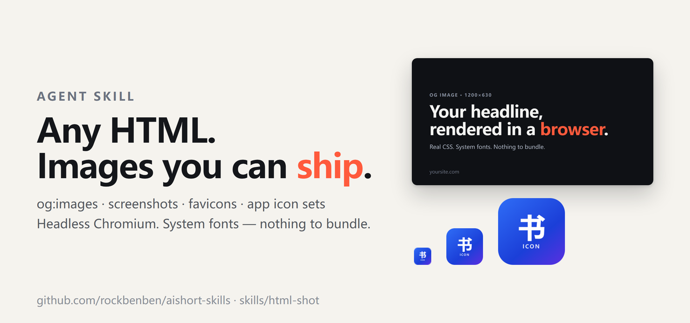

# html-shot

> Turn HTML, SVG or a URL into PNG/JPEG/WebP, and build favicon and app-icon sets.

[](https://github.com/rockbenben/aishort-skills/blob/main/LICENSE) [](https://github.com/rockbenben/365opensource)

[中文文档](README.zh.md)



> [!TIP]
> A local file is served from a throwaway `127.0.0.1` server and rendered by a local headless Chromium, so your markup never leaves the machine. The page's JavaScript does run, and the browser can make outbound requests to whatever the page references — render only input you trust.

## Installation

Pick whichever matches your agent / CLI:

```bash
# ClawHub / OpenClaw
clawhub install html-shot

# skills.sh (Vercel skills CLI — Claude Code, Cursor, and more)
npx skills add rockbenben/aishort-skills --skill html-shot
```

`--skill html-shot` installs only this skill. For reproducible installation, pin a reviewed
CLI version with `skills@<version>`; otherwise the command resolves the current registry version.

Or install manually — clone this repo and copy (or symlink) the `skills/html-shot/` folder
into the skills directory your agent reads from. A single folder named `html-shot` is all
it needs; use whichever path your agent documents.

## What this touches

Scope in one line: it runs `node` locally, reads the input file you name, writes the
output image you name, and needs no credentials.

- **Reads the input file** you name and **writes the output image** where you say. For a
  local file it also serves that file's own directory plus the nearest project `public/`
  folder (or an explicit `--base`) — and nothing else in your project.
- **Launches Chromium against 127.0.0.1** for local files, over a throwaway per-run
  server; against the URL you gave it for remote input.
- **Sends data nowhere except the URL you ask it to render** and the assets that page
  requests. It needs no account, API key, cookie, or other credential.
- **Touches no other skill**, reads no other skill's files, installs no startup entry,
  schedules no cron job, and starts no background service. Working files stay in the
  directory you chose and are not remembered across sessions.

## Support

| Dimension | Supported |
| --- | --- |
| Runtime | Node.js ≥ 20.9 on Windows, macOS and glibc Linux. No Alpine/musl: Playwright publishes no musl Chromium build, so `node:*-alpine` images fail at browser launch. |
| Browser | The Chromium Playwright downloads, or one you already have via `--executable` / `--channel chrome` |
| Input | Local HTML and SVG, `file://` URLs, `http(s)` URLs |
| Output | PNG, JPEG, WebP — plus `.ico`, `.icns`, apple-touch and PWA icon sets |
| Fonts | Not bundled — system fonts plus any web fonts the page loads; CJK and emoji need host fonts |
| Dependencies | `sharp` ≥ 0.35.5, `png2icons`, Playwright — `npm ci` installs them |

## Features

- Render an HTML design, an SVG or a live page to PNG, JPEG or WebP — an og card, a badge, one element or the full scroll.
- `--transparent` drops the browser's white backdrop, and `inspect.mjs` reports whether real pixels are transparent rather than merely whether an alpha channel exists.
- `--dpr` sets the output density, `--scale` sets render supersampling; output pixels are the CSS size times `--dpr`.
- Icon sets for favicon, PWA, Next, Electron and Tauri, with the `.ico`, `.icns`, apple-touch and manifest snippets each one expects.
- SVG rasterisation that repairs a missing or invalid `viewBox` from the root's width/height instead of rendering an empty frame.
- A failed asset or a page error exits non-zero, so a written image is never mistaken for a successful capture.

## When not to use this

- A plain "网页截图" / "screenshot the page" request with no output file, size, or format named — that is a general page capture, not an image asset. Ask for the destination, pixel size, and format first. If the answer is "a screenshot for me to look at" rather than a deliverable file, this skill is the wrong tool.
- "生成 og 图" / "turn this design into a 2x og image" with no source file or URL — ask which HTML or SVG to render. This skill renders a source you already have; it does not invent the design.
- Editing an existing raster image (crop, retouch, convert) — use an image editor.
- Charts and diagrams built from data — use a chart/diagram tool, then render the result if an image is needed.

## Quick start

The skill installs into any agent that loads skills — ClawHub, OpenClaw, Claude Code, Cursor — and then asks for the asset itself:

```text
Render this og card as a 1200×630 PNG: card.html
Set this logo as the favicon and the PWA icon set: logo.svg
```

To drive the CLI yourself, install its dependencies once inside the skill directory:

```bash
npm ci
node node_modules/playwright/cli.js install chromium
node render.mjs template.example.html card.png
```

```
✔ card.png  1200×630  png
```

## Usage

| Flag | What it does |
| --- | --- |
| `--selector CSS` | Capture one element instead of the body |
| `--full` | Capture the whole scrollable page |
| `--dpr N` | Output density, default 1; output pixels = CSS size × dpr |
| `--scale N` | Render supersampling, default 2; does not change the output size |
| `--transparent` | Drop the browser's white backdrop |
| `--palette`, `--colors N` | Indexed PNG up to 256 colours; `--colors` selects 2/4/16/256 (implies palette) — lossy |
| `--wait-for CSS` | Wait for a readiness marker instead of a fixed sleep |
| `--offline` | Refuse every request except those to the render's own local server |
| `--timeout MS`, `--max-pixels N` | Stop a runaway capture; 60 s and 64 MP by default |
| `--executable PATH`, `--channel NAME` | Use a browser that is already installed |

Full flag list in [references/cli.md](references/cli.md) · icon presets in [references/icons.md](references/icons.md) · starter templates in [references/templates.md](references/templates.md) · trust model in [references/security.md](references/security.md)

## Limits

- The renderer executes the page's JavaScript — treat the input as code you trust, not as data that needs sandboxing.
- Fonts are not bundled, so CJK or emoji glyphs the host does not have come out as empty boxes.
- An icon whose source is smaller than the platform asks for is refused, not quietly written small under a platform-sized name; `--allow-upscale` keeps the size and loses the detail.
- Identical pixels on another machine are not promised: fonts and rasterisers differ.
- `--offline` blocks requests inside the browser context; it is not a firewall and not a sandbox.

## Tests

```bash
npm test
npm run test:integration
```

Set `HTML_SHOT_EXECUTABLE` to use a browser you already have. Cases that need symlink creation are skipped where the OS forbids it, so a green run does not cover those paths.

## About the 365 Open Source Plan

Project **#030** of the [365 Open Source Plan](https://github.com/rockbenben/365opensource) — one person + AI, 300+ open-source projects in a year.

[Submit your idea →](https://365.aishort.top/) · [Discord](https://discord.gg/PZTQfJ4GjX) · [Telegram](https://t.me/aishort_top)
