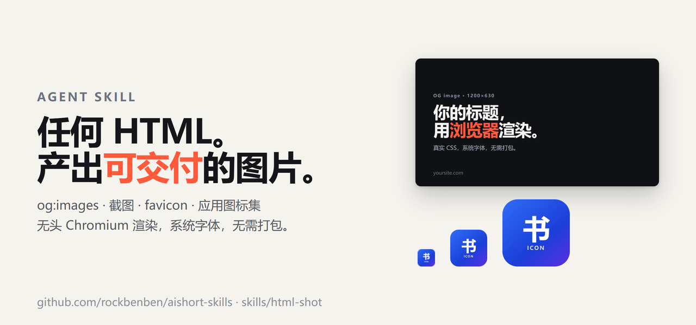

# html-shot

> 把 HTML、SVG 或网页渲染成 PNG，并生成 favicon 与应用图标集。

[](https://github.com/rockbenben/aishort-skills/blob/main/LICENSE) [](https://github.com/rockbenben/365opensource)

[English](README.md)



> [!TIP]
> 本地文件由一个一次性的 `127.0.0.1` 服务托管，交给本机的无头 Chromium 渲染，标记内容不会离开这台机器。页面里的 JavaScript 确实会执行，浏览器也会去请求页面自己引用的外部资源 —— 只渲染你信任的输入。

## 安装

按你使用的 agent / CLI 任选其一：

```bash
# ClawHub / OpenClaw
clawhub install html-shot

# skills.sh（Vercel skills CLI —— 适用于 Claude Code、Cursor 等）
npx skills add rockbenben/aishort-skills --skill html-shot
```

`--skill html-shot` 只安装这个技能。需要可复现安装时，用 `skills@<version>` 固定已核对的 CLI 版本；不指定版本则安装包源当前版本。

或手动安装 —— clone 本仓库，把 `skills/html-shot/` 目录拷贝（或软链）进你的 agent 读取的
skills 目录即可，只要是一个名为 `html-shot` 的目录，具体路径按你的 agent 文档来。

## 会碰哪些东西

范围就这么多：它在本地跑 `node`，读取你指定的输入文件，写出你指定的输出图片，不需要任何凭据。

- **读取你指定的输入文件**，**把输出图片写到你指定的位置**。渲染本地文件时还会提供该文件所在
  目录，以及最近一层项目的 `public/` 目录（或你显式指定的 `--base`）—— 你项目里的其他内容一概不碰。
- **对 127.0.0.1 启动 Chromium**：本地文件走一次性的临时服务，远程输入则直接访问你给的 URL。
- **除了你要渲染的 URL 以及那个页面自己请求的资源，不向任何地方发送数据**。不需要账号、API key、
  cookie 或其他任何凭据。
- **不碰其他技能**，不读别的技能的文件，不装开机自启项，不建定时任务，不起后台服务。工作文件只留在
  你选的目录里，跨会话不会被记住。

## 支持范围

| 维度 | 支持 |
| --- | --- |
| 运行环境 | Node.js ≥ 20.9，Windows / macOS / glibc Linux。不支持 Alpine/musl：Playwright 没有 musl 版 Chromium，`node:*-alpine` 镜像会在启动浏览器时失败。 |
| 浏览器 | Playwright 下载的 Chromium，或用 `--executable` / `--channel chrome` 指定本机已有的浏览器 |
| 输入 | 本地 HTML 与 SVG、`file://` URL、`http(s)` URL |
| 输出 | PNG、JPEG、WebP，以及 `.ico`、`.icns`、apple-touch 与 PWA 图标集 |
| 字体 | 不打包字体 —— 使用系统字体和页面自己加载的 Web 字体；中文与 emoji 需要系统已装好 |
| 依赖 | `sharp` ≥ 0.35.5、`png2icons`、Playwright —— `npm ci` 会装好 |

## 能做什么

- 把 HTML 设计、SVG 或在线页面渲染成 PNG、JPEG、WebP —— og 图、徽章、单个元素或整页长图。
- `--transparent` 去掉浏览器的白底；`inspect.mjs` 检查的是真实像素是否透明，而不只是有没有 alpha 通道。
- `--dpr` 决定输出密度，`--scale` 决定渲染超采样；输出像素 = CSS 尺寸 × `--dpr`。
- favicon、PWA、Next、Electron、Tauri 图标集，附各自需要的 `.ico`、`.icns`、apple-touch 与 manifest 片段。
- SVG 栅格化时用根元素的 width/height 补全缺失或非法的 `viewBox`，而不是渲染出一张空图。
- 资源缺失或页面报错一律非零退出，写出来的图不会被当成成功结果。

## 什么时候不要用这个技能

- 只是说"网页截图"/"screenshot the page"，却没有给出输出文件、尺寸或格式 —— 那只是一次普通的页面截取，
  不是要产出一个图片资源。先问清楚目标路径、像素尺寸和格式。如果对方要的是"给我看一眼"，而不是一份
  交付文件，这个技能就不合适。
- 只说"生成 og 图"/"turn this design into a 2x og image"，却没给源文件或 URL —— 先问清楚要渲染哪份
  HTML 或 SVG。这个技能渲染的是你已有的源文件，它不会替你设计稿子。
- 修改已有的位图（裁剪、修图、格式转换）—— 用图像编辑器。
- 从数据生成图表或示意图 —— 用图表工具，需要图片时再把结果渲染出来。

## 快速开始

技能装进任何支持技能的代理 —— ClawHub、OpenClaw、Claude Code、Cursor —— 之后直接说你要什么：

```text
把这张 og 卡渲染成 1200×630 的 PNG：card.html
把这个 logo 设成 favicon 和 PWA 图标集：logo.svg
```

想自己跑 CLI，先在技能目录里装一次依赖：

```bash
npm ci
node node_modules/playwright/cli.js install chromium
node render.mjs template.example.html card.png
```

```
✔ card.png  1200×630  png
```

## 常用参数

| 参数 | 作用 |
| --- | --- |
| `--selector CSS` | 截取单个元素，而不是 body |
| `--full` | 截取整页滚动内容 |
| `--dpr N` | 输出密度，默认 1；输出像素 = CSS 尺寸 × dpr |
| `--scale N` | 渲染超采样，默认 2；不改变最终尺寸 |
| `--transparent` | 去掉浏览器的白底 |
| `--palette`、`--colors N` | indexed PNG，最多 256 色；`--colors` 取 2/4/16/256（隐含 `--palette`）—— 有损 |
| `--wait-for CSS` | 等一个就绪标记，而不是固定睡眠 |
| `--offline` | 除发往本次渲染本地服务的请求外，一律拒绝 |
| `--timeout MS`、`--max-pixels N` | 拦住失控的截图；默认 60 秒 / 6400 万像素 |
| `--executable PATH`、`--channel NAME` | 使用已经装好的浏览器 |

完整参数见 [references/cli.md](references/cli.md) · 图标预设见 [references/icons.md](references/icons.md) · 起始模板见 [references/templates.md](references/templates.md) · 信任边界见 [references/security.md](references/security.md)

## 边界与限制

- 渲染器会执行页面里的 JavaScript —— 把输入当成你信任的代码，而不是需要沙箱的数据。
- 字体不打包，系统没有的中文或 emoji 字形会变成空框。
- 主图分辨率低于平台要求时直接失败，不会悄悄写一个按源尺寸的小文件却顶着平台尺寸的文件名；要保留尺寸就传 `--allow-upscale`，细节不会因此回来。
- 不承诺在另一台机器上像素完全一致：字体与光栅器都不同。
- `--offline` 只在浏览器上下文里拦请求，不是防火墙，也不是沙箱。

## 测试

```bash
npm test
npm run test:integration
```

用 `HTML_SHOT_EXECUTABLE` 可以指定本机已有的浏览器。需要创建符号链接的用例，在系统禁止建链接时会跳过，因此测试全绿不代表这些路径已覆盖。

## 关于 365 开源计划

[365 开源计划](https://github.com/rockbenben/365opensource) 的第 **#030** 个项目——一个人 + AI，一年 300+ 个开源项目。

[提交你的需求 →](https://365.aishort.top/) · [Discord](https://discord.gg/PZTQfJ4GjX) · [Telegram](https://t.me/aishort_top)
